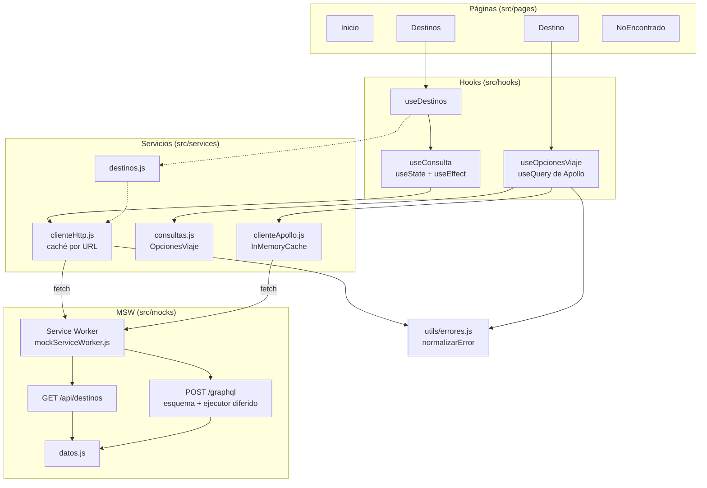
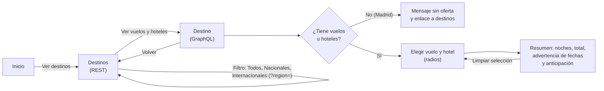
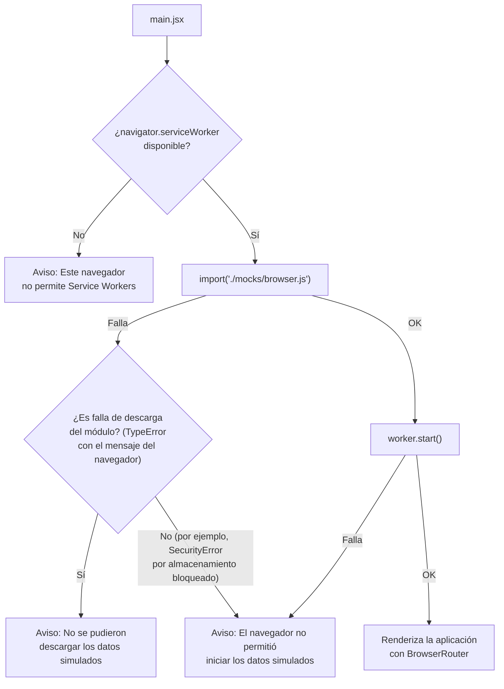

# Diagramas

GitHub muestra estos diagramas directamente a partir del código Mermaid.

## Arquitectura

Las páginas usan hooks; los hooks usan los servicios; las peticiones las responde el Service Worker de MSW con los handlers y los datos del mock.



## Flujo del usuario



## Arranque del mock y sus avisos



## Flujo de una consulta con caché y errores

Consulta REST con `useConsulta`. La consulta GraphQL sigue el mismo esquema con la caché de Apollo (`cache-first`) y `refetch()` para reintentar.

```mermaid
sequenceDiagram
  participant P as Página
  participant H as useConsulta
  participant C as clienteHttp
  participant W as MSW (Service Worker)

  P->>H: useDestinos()
  H->>C: leerCache(ruta)
  alt Hay datos en caché
    C-->>H: datos
    H-->>P: datos, sin indicador de carga
  else Sin caché
    H-->>P: cargando (aria-busy)
    H->>C: obtenerJson(ruta, signal)
    C->>W: fetch (o se une a la petición en curso)
    W->>W: esperarRed(): demora y modo de simulación
    alt Normal
      W-->>C: 200 con datos
      C->>C: guarda en caché
      C-->>H: datos
      H-->>P: datos
    else Error del servidor o sin conexión
      W-->>C: 500 o falla de red
      C-->>H: normalizarError: servidor o red (no se guarda en caché)
      H-->>P: aviso con Reintentar y enlace de salida
      P->>H: reintentar()
      H->>C: obtenerJson(ruta, forzar)
    end
  end
  Note over H,C: Al desmontar, el efecto cancela con AbortController;<br/>una cancelación nunca se muestra como error
```
