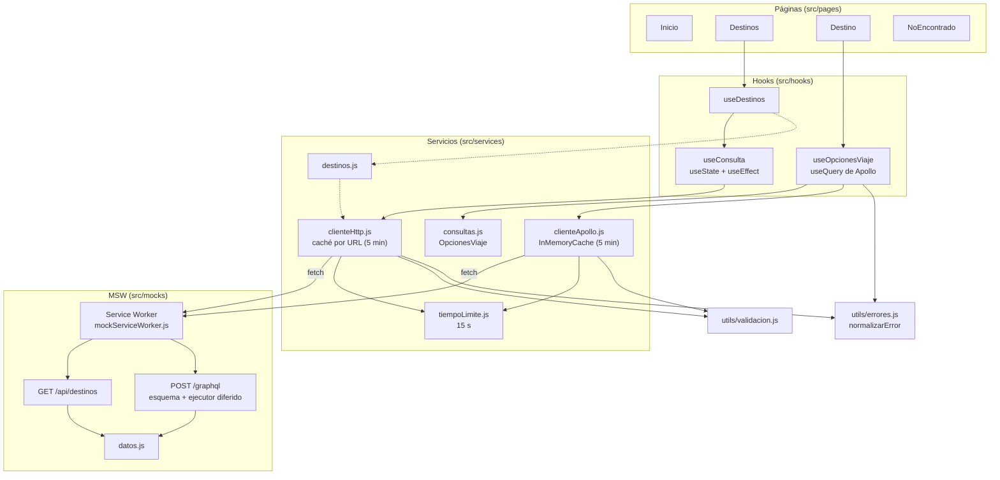
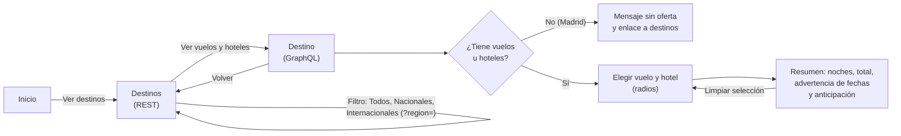
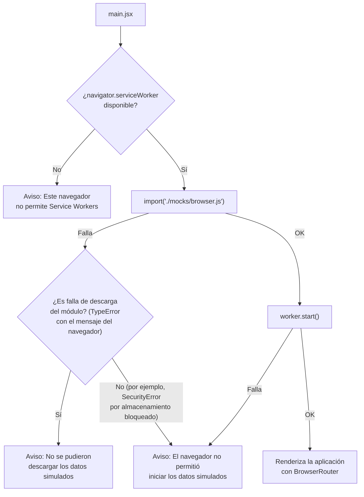
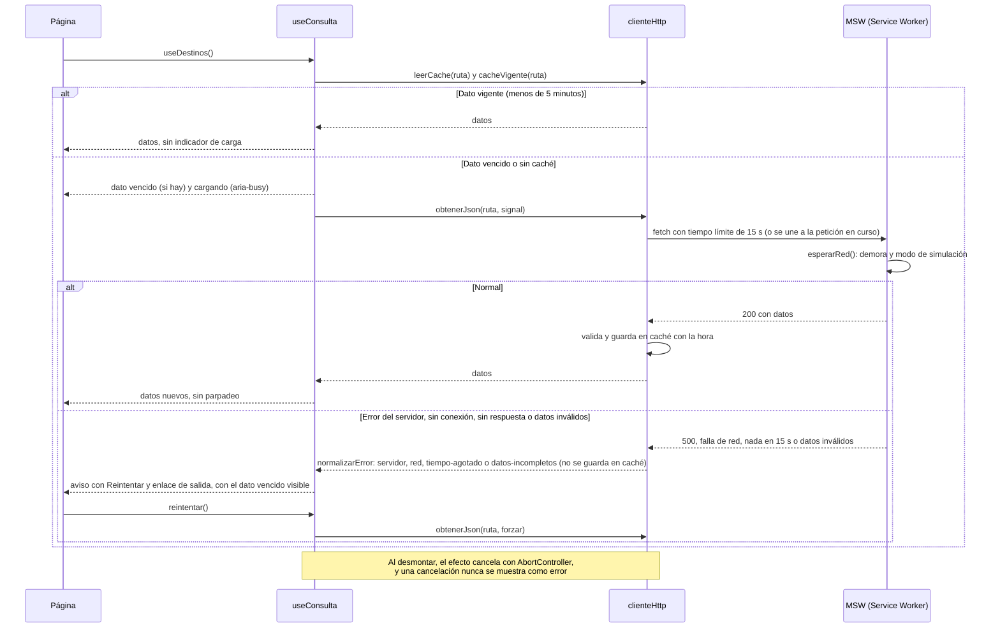
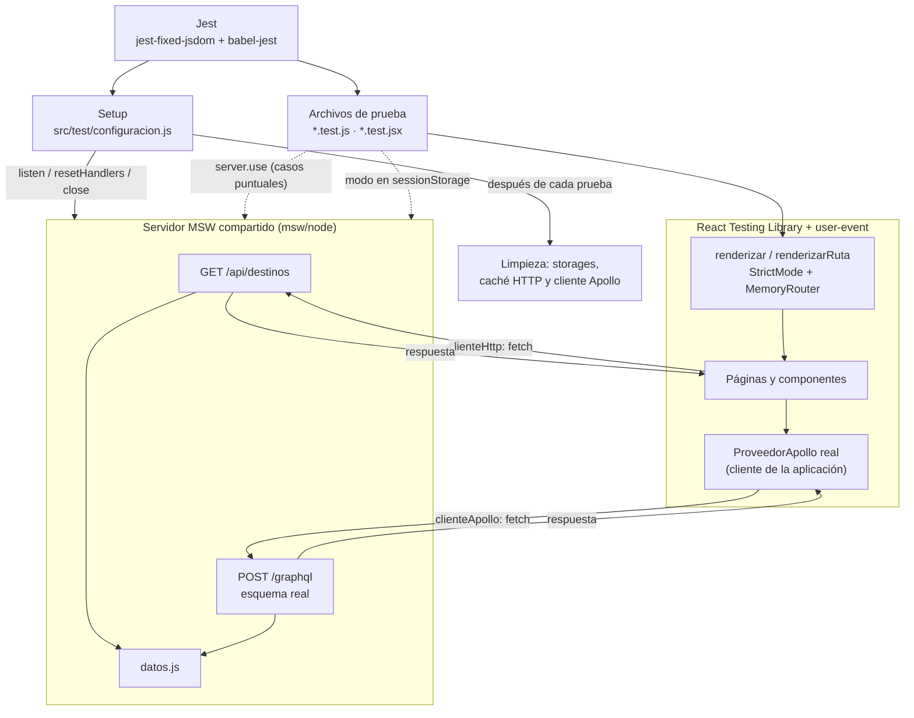

# Diagramas

GitHub muestra estos diagramas directamente a partir del código Mermaid.

## Arquitectura

Las páginas usan hooks; los hooks usan los servicios; las peticiones las responde el Service Worker de MSW con los handlers y los datos del mock.

## Flujo del usuario

## Arranque del mock y sus avisos

## Flujo de una consulta con caché y errores

Consulta REST con `useConsulta`. La consulta GraphQL sigue el mismo esquema con la caché de Apollo: `cache-first` con un dato vigente, `cache-and-network` con uno vencido y `refetch()` para reintentar.

## Arquitectura de pruebas

Jest carga el setup en cada archivo; el setup inicia un servidor MSW único con los mismos manejadores del navegador. Las pruebas renderizan la interfaz con React Testing Library dentro de un `MemoryRouter`, y las páginas usan los clientes reales, cuyas peticiones responde ese servidor.

