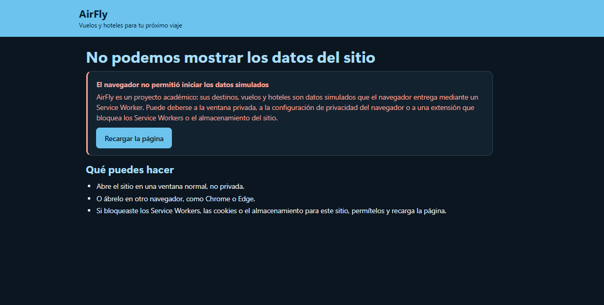

# Pruebas

## Pruebas automatizadas

Se ejecutan con Vitest en Node, sin navegador:

```bash
npm run test
```

Resultado actual: **225 pruebas en 11 archivos, todas aprobadas.**

| Archivo | Pruebas | Qué cubre |
| --- | --- | --- |
| [`mocks/handlers.test.js`](../src/mocks/handlers.test.js) | 38 | REST: lista, ids únicos, 500 con `{ mensaje }` y falla de red. GraphQL: destino con vuelos y hoteles, solo los campos pedidos, sin oferta, ids equivalentes, `NOT_FOUND`, `BAD_USER_INPUT`, 500 y falla de red. Datos: ids, códigos IATA, estadías que calzan con algún vuelo, opciones agotadas y la coherencia de los 16 horarios con los husos horarios |
| [`utils/errores.test.js`](../src/utils/errores.test.js) | 31 | `normalizarError` con errores REST y con las clases reales de Apollo 4 (`CombinedGraphQLErrors`, `ServerError`, `ServerParseError`, `UnconventionalError`), red y cancelación |
| [`utils/viaje.test.js`](../src/utils/viaje.test.js) | 28 | Noches (incluido el cambio de horario), totales, fechas que calzan, disponibilidad y anticipación recomendada |
| [`utils/destinos.test.js`](../src/utils/destinos.test.js) | 24 | Destino nacional, normalización de la región de la URL, filtro y texto "Mostrando N de M destinos" |
| [`utils/mock.test.js`](../src/utils/mock.test.js) | 22 | Soporte de Service Workers, falla de descarga de cada navegador y clasificación del arranque (incluido el `SecurityError` por almacenamiento bloqueado) |
| [`utils/formato.test.js`](../src/utils/formato.test.js) | 19 | Precios en CLP, fechas es-CL, escalas, noches, disponibilidad y duración |
| [`utils/ids.test.js`](../src/utils/ids.test.js) | 18 | `convertirEntero` con ids válidos e inválidos |
| [`services/clienteApollo.test.js`](../src/services/clienteApollo.test.js) | 16 | Integración del cliente Apollo real con el mock: caché normalizada, una sola petición al volver a un destino, ids equivalentes, errores que no quedan en caché y la clase de error de Apollo en cada modo con su tipo normalizado |
| [`utils/almacenamiento.test.js`](../src/utils/almacenamiento.test.js) | 14 | Lectura y escritura de `localStorage` y `sessionStorage` disponibles, bloqueados (`SecurityError`) o inexistentes; modo de simulación y tema con valores por defecto |
| [`services/clienteHttp.test.js`](../src/services/clienteHttp.test.js) | 12 | Caché por URL, peticiones compartidas, cancelación (incluido el doble efecto de StrictMode) y errores 404, 500, red y JSON inválido |
| [`services/destinos.test.js`](../src/services/destinos.test.js) | 3 | Servicio de destinos: caché, error que no queda en caché y cancelación |

Las pruebas de los handlers y de los clientes usan los handlers reales del mock con `msw/node`.

**Las pruebas detectan fallas.** Se introdujeron cinco errores a propósito, uno por vez, y en cada caso fallaron pruebas; al restaurar el código vuelven a pasar las 225:

| Error introducido | Pruebas que fallaron |
| --- | --- |
| `fechasCalzan` con `>` en lugar de `>=` | 1 |
| Hora de llegada de un vuelo a Rapa Nui alterada en los datos | 1 |
| `NOT_FOUND` traducido como error del servidor | 2 |
| El cliente HTTP no guarda en caché | 5 |
| El modo "Error del servidor" de GraphQL responde 200 en vez de 500 | 1 |

## Matriz de pruebas en navegadores

Pruebas manuales en el [sitio publicado](https://l0ncho.github.io/viajes-alonso-basualdo-pfy2202/).

**Navegadores elegidos:** dos navegadores con motores distintos. Chrome en Windows usa Chromium; Safari en iPhone usa WebKit, que es además el motor de todos los navegadores en iOS, así que también cubre el uso en celular.

**Versiones mínimas que soporta Tailwind CSS v4:** Chrome 111, Safari 16.4 y Firefox 128. En navegadores más antiguos los estilos pueden no aplicarse correctamente.

| | Chrome (Windows) | Safari (iPhone) |
| --- | --- | --- |
| **Versión** | Chrome 157.0.8103.79 (64 bits) en Windows | Safari en iOS 27.2.1 |

| # | Caso | Pasos | Resultado esperado | Chrome (Windows) | Safari (iPhone) |
| --- | --- | --- | --- | --- | --- |
| 1 | Flujo principal | Inicio → Ver destinos → un destino → Volver | Cada página carga con su título y sus datos; Volver regresa a Destinos | OK | OK |
| 2 | Filtro de destinos | Elegir Nacionales, luego Internacionales y recargar | 4 y 4 destinos; "Mostrando 4 de 8 destinos"; la URL cambia y el filtro se mantiene al recargar | OK | OK |
| 3 | Selección y total | En San Pedro de Atacama, elegir el vuelo de AeroAndes y el Hotel Desierto Rojo; luego el Lodge Altiplano; luego Limpiar selección | Total $679.990 y 5 noches de viaje y de hotel; advertencia de fechas con Lodge Altiplano; Limpiar vuelve al mensaje inicial | OK | OK |
| 4 | Errores con el selector "Simulación de la API" | "Error del servidor (500)" y abrir un destino no visitado; volver a Normal y Reintentar; repetir con "Sin conexión" | "Error del servidor" o "Sin conexión", con Reintentar y enlace a Destinos; al reintentar en Normal llegan los datos | OK | OK |
| 5 | Página 404 | Abrir una URL inexistente, por ejemplo `/cualquier-cosa` | "Página no encontrada" con Volver e Ir al inicio | OK | OK |
| 6 | Recarga en una ruta interna | Recargar estando en `/destinos/1` | La página del destino carga normalmente (no aparece el 404 de GitHub Pages) | OK | OK |
| 7 | Pantalla de celular o 360 px | Recorrer Destinos y un destino a 360 px (en Chrome) o en el iPhone | Una columna, sin desplazamiento horizontal; el resumen del viaje al final | OK | OK |
| 8 | Ambos temas | Alternar "Modo oscuro" y recorrer las páginas | Textos legibles en ambos temas; la preferencia se mantiene al recargar | OK | OK |

**Resultado:** los 8 casos aprobados en ambos navegadores, sin fallas.

## Errores encontrados y corregidos

### Aviso equivocado con el almacenamiento bloqueado (Chrome)

**Cómo se encontró:** al probar en Chrome con el almacenamiento bloqueado para el sitio ("No se permite guardar datos").

**Antes:** se mostraba "No se pudieron descargar los datos simulados… Revisa tu conexión a internet", aunque la conexión estaba bien.


**Causa:** MSW lee `localStorage` al cargarse. Con el almacenamiento bloqueado, Chrome lanza `SecurityError`, el `import()` del mock fallaba y el arranque lo clasificaba como una falla de descarga.

**Corrección:** solo un error de descarga del módulo se clasifica como falla de carga; cualquier otro error al importar o iniciar el mock se informa como que el navegador no permitió iniciarlo. Además, todo acceso al almacenamiento del proyecto captura el `SecurityError` y usa valores por defecto. Detalle en [decisiones técnicas](decisiones-tecnicas.md#aviso-de-service-worker-no-disponible); lo cubren [`mock.test.js`](../src/utils/mock.test.js) y [`almacenamiento.test.js`](../src/utils/almacenamiento.test.js).

**Después:** se muestra "El navegador no permitió iniciar los datos simulados", con la causa probable y qué hacer.



### Errores encontrados durante el desarrollo

Detectados por las pruebas automatizadas o al revisar el build, y corregidos antes de publicar:

| Error | Cómo se detectó | Corrección |
| --- | --- | --- |
| Una consulta GraphQL anónima respondía "Unknown operation named """ | Prueba "responde solo los campos que pide la consulta" | MSW entrega `operationName` vacío; el handler lo pasa como `undefined` |
| El 500 de GraphQL no llegaba como `ServerError` | Prueba de integración del cliente Apollo | Apollo 4 lo entrega como `CombinedGraphQLErrors`; `normalizarError` lo traduce por `extensions.code` |
| `graphql` completo se descargaba antes del primer render en todas las páginas | Revisión de las importaciones entre archivos del build | División en `graphql-lenguaje` y `graphql` en `vite.config.js` |
